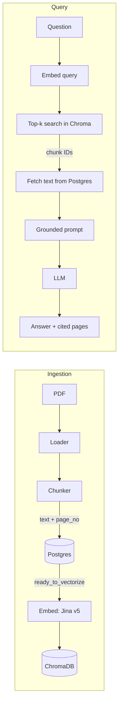

# sourcely

A RAG chatbot that answers questions from PDF documents and cites its sources down to the page. Every answer links back to the exact page it came from.

Sample corpus:
[Claude Opus 5.5 System Card]
Link: (https://www-cdn.anthropic.com/fc1b44717c85dc068bc6ba5024219938094694bd/Claude%20Opus%205.5%20System%20Card.pdf)
(230 pages, 575 chunks).

## What makes it more than a demo

- **Page-level citations.** The model cites sources as `[1]`, `[2]`. Only the sources it actually cited are returned, each as a link that opens the PDF at that page (`#page=N`).
- **Two stores, one ID.** Postgres is the source of truth for text and metadata. ChromaDB holds only vectors. Both share the same chunk UUID, so retrieval is a vector lookup followed by a Postgres fetch.
- **Separate ingestion pipeline.** Load, chunk and vectorize are independent scripts. Each chunk carries a `status` (`ready_to_vectorize` → `vectorized`), so a failed run resumes where it stopped, and re-runs are safe because vectors are upserted.
- **Asymmetric retrieval.** Questions and passages are embedded with different Jina tasks (`retrieval.query` and `retrieval.passage`), searched by cosine distance.
- **Grounded answers.** The prompt restricts the model to the retrieved sources and tells it to say so when the answer isn't there.
- **Schema migrations.** Tables are managed with Alembic, not created ad hoc.
- **Config out of code.** Secrets live in environment variables, and the LLM sits behind a single `generate()` function, so swapping providers touches one file.

## How it works



## Stack

· FastAPI 
· PostgreSQL 
· SQLAlchemy 
· Alembic 
· ChromaDB 
· LangChain (loading and chunking) 
· Jina embeddings v5 
· Groq (`openai/gpt-oss-20b`) 
· plain HTML frontend

## Run locally

Requires Python 3.12, [uv](https://docs.astral.sh/uv/) and a running PostgreSQL.

```bash
uv sync
cp src/model_rag/.env.example .env      # then fill in your values
uv run alembic upgrade head             # create tables

# ingest a PDF (set PDF_PATH, TITLE and SOURCE_URL in scripts/chunking.py first)
uv run python -m model_rag.scripts.chunking
uv run python -m model_rag.scripts.vectorize

uv run uvicorn model_rag.main:app --reload
```

Open http://127.0.0.1:8000 and ask a question.

## API

`POST /ask` with `{"query": "..."}` returns:

```json
{
  "answer": "… published on September 22, 2026 [1].",
  "references": [
    {"number": 1, "title": "Claude Opus 5.5 System Card", "page_no": 1, "url": "…pdf#page=1"}
  ]
}
```

## Roadmap

1 - Auth (JWT) and document-level access control
2 - Evaluation set for retrieval and answer quality
3 - Request logging: query, retrieved chunk IDs, latency
4 - Docker Compose for Postgres, Chroma and the API
5 - Hybrid search and reranking
6 - Multi-document ingestion
